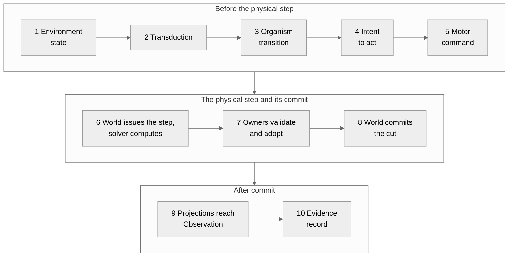

# One step across the domains

This document is derived. It adds no fact of its own: every statement about
code comes from one of the unit documents it links to, and each of those
names the commit it was reviewed against; every statement about what is
decided comes from the decision record, design or owner decision it cites. If a unit document and this one disagree, the
unit document is right and this one is out of date. In the registry this
document depends on every unit it draws from, so a change in any of them
marks it for review.

## Why this document exists

Biopeia separates four authorities, Organism, Embodiment, Environment and
World, two capabilities, Modality and Observation, and one apparatus, Lab
([ADR-0095](../../technical/adr/ADR-0095-surviving-semantic-authorities.md),
[ADR-0110](../../technical/adr/ADR-0110-repository-consequence-and-dependency-direction.md)).
Each lives in its own repository. The unit documents describe each piece. A
reader also needs to see one thing happen across all of them: something in
the environment reaches an organism, the organism acts, a body moves, the
world records it, and someone outside can look.

That chain is the intended shape of a causal step. What follows goes link by
link and says, for each, what exists in code today. The summary comes first
because it is the main result.

## The chain today, in one table

| Link | Exists as | Where |
|---|---|---|
| Environment holds external truth | Source code | [finite resource](../environment/finite-resource.md), [static scene](../environment/static-scene.md) |
| Environment to Organism, through transduction | Nothing: a constant in a test | [Modality](../modality/current-state.md) |
| Organism produces a motor command | Six separate source pieces; joined only in a test fixture | [action path](../organism/action-path.md) |
| Motor command to effectors | Source code | [actuation projection](../embodiment/actuation-projection.md) |
| A solver computes a candidate | Functions inside two test fixtures | [physical step](../world/physical-step.md) |
| Embodiment adopts the candidate | Source code | [physical state](../embodiment/physical-state.md) |
| Environment adopts its side | Source code, for an unchanged scene only | [static scene](../environment/static-scene.md) |
| World commits the cut | Source code | [durable runtime](../world/durable-runtime.md), [manifest](../world/causal-manifest.md) |
| Observation of the committed cut | Claim types in source; built by a test fixture; nothing published | [claim model](../observation/semantic-claim-model.md), [plane](../observation/observation-plane.md) |
| Lab records evidence | Source code, for an operator's transfer only | [operator material transfer](../lab/operator-material-transfer.md) |

Read down the middle column. The pieces owned by a single domain exist. What
connects one domain to the next mostly does not exist outside tests. World
has a coordinator that sequences projection, solving, adoption and commit for
one physical step, but the adapters it is given, and the solver, are written
inside test fixtures; nothing in any repository runs the whole chain.

## Link by link

### What the environment holds

Environment owns two kinds of truth that this chain touches: a quantity that
can be used up, and the fixed geometry and gravity a body stands in. Both
are independent of any solver and of any organism. Neither assigns meaning:
a resource is a quantity at a place, not food. See
[the finite resource](../environment/finite-resource.md) and
[the static scene](../environment/static-scene.md).

### From the environment to the organism

Between a phenomenon outside and a number inside there should be
transduction, and Modality is where its rules are decided to live. The
`modality` package is empty. The only place a signal passes from an
environment to an organism is a World integration test, in which the value
is a constant and is handed over unchanged. See
[Modality: decided role and current state](../modality/current-state.md).

So the chain has no first link in code. An organism in Biopeia does not yet
receive anything from an environment through a transducer.

### What the organism does

Organism has the records and functions from which a motor command is built:
an affordance is admitted, an intent is activated, a proposal is arbitrated
into a commitment, and a controller yields a command addressed to actuators
by opaque identifier. These are six separate pieces; no code in the Organism
repository joins them. See [how an Organism acts](../organism/action-path.md),
which is careful to describe operations on data structures and not to claim
intention or decision in any wider sense.

What makes an Organism the same Organism, and what a portable checkpoint of
it carries, is described in
[identity and the checkpoint boundary](../organism/identity-and-checkpoint.md).

### From a command to a body

Embodiment translates the command into channels on named effectors. It
matches by identifier and never by position, takes quantity, unit and range
from the body's morphology, refuses what is out of range, and gives no value
to an effector the command does not mention. Embodiment states the shape of
the command it accepts and does not import Organism. See
[actuation projection](../embodiment/actuation-projection.md).

### The solver

A solver computes where the body ends up. By decision it is a numerical
substrate and not an authority
([ADR-0098](../../technical/adr/ADR-0098-physical-substrate-and-causal-integration.md)).
In code, the only calls that advance a physical simulation are in two World
test fixtures. See [the physical causal step](../world/physical-step.md).

### Adoption by the owners

The solver's result is a proposal. Embodiment accepts it for the body only
if it carries the correlation of the step that was expected, and then
returns the body's state at the next tick. Environment does the same for its
scene, and for a static scene accepts only no change at all. See
[the body's physical state](../embodiment/physical-state.md) and
[the static scene](../environment/static-scene.md).

Each of the two has its own definition of the correlation, and neither can
verify that World authorised it.

### The commit

World does not hold any of that state. It opens a transition durably, asks
the owners to save, checks that the references they return name exactly the
expected participants and intact checkpoints that each owner's contract
accepts, extends its journal, and publishes the manifest of the new cut. If
anything fails after the transition opened, the World requires an explicit
recovery. See [the durable World runtime](../world/durable-runtime.md),
[the causal manifest](../world/causal-manifest.md) and
[recovery](../world/recovery.md).

This is the most complete link. It is also the one whose limits are best
known: one logical writer is assumed and not enforced, and no test stops a
process mid-write.

### Looking at it

After a commit, statements about the World, the body and the environment
can be expressed as semantic claims, each naming the authority that owns its
meaning. Observation has the claim types and an in-memory plane that would
hold and deliver them. No authority has an adapter to Observation, and
nothing publishes to the plane outside its own tests. See
[the semantic claim model](../observation/semantic-claim-model.md) and
[the observation plane](../observation/observation-plane.md).

### Evidence

Lab is the apparatus that records durable evidence. Its one cross-domain
operation today is not part of this chain: it is an operator's request to
move a quantity from a resource to a body, outside any action by an
organism. It does show the pattern of a Lab evidence record taking part in a
World cut. See
[the operator material transfer](../lab/operator-material-transfer.md).

## What binds one domain to the next

The registry records each cross-domain contract and how its two sides are
tied in code (`registry/contracts.yaml`). Across the contracts recorded so
far:

- Only Lab's source imports other domains. The six other repositories import
  none.
- Where two authorities meet, one side declares a shape and the other
  happens to fit it: World's two validation questions to an owner,
  Embodiment's expected command.
- The correlation of a physical step and the observation of a committed cut
  are tied together only by a test fixture.

## The same step as it is decided

Everything above says what exists. This section sets beside it what has been
decided, so that the distance between the two can be read off. It describes
no code.

The accepted contracts for the physical step are in
[ADR-0073](../../technical/adr/ADR-0073-biopeia-migration-causal-and-physical-contracts.md),
which adopts the design
[Biopeia Physical-Step and Causal-Commit Integration v1](../../technical/design/runtime/biopeia-physical-step-integration-v1.md).
The design register records that design as approved, its implementation as
partial and its scope as target. The whole cycle, from the environment to
an observer, is the ten steps the owner requires to be shown before the
migration closes
([workspace#7](https://github.com/biopeia/workspace/issues/7), decision of
2026-10-10; [world#86](https://github.com/biopeia/world/issues/86) carries
it).

The ten steps as decided. The diagram shows the order that is required, not
anything that runs.

| Step, as decided | What must hold | Today |
|---|---|---|
| 1. Environment owns the external state | Environment owns environmental truth and its meaning (ADR-0074) | Exists in source |
| 2. Modality transduces it into an opaque input | Transduction, not interpretation; every persistent state it needs has one owner, and none is Modality's (ADR-0099, ADR-0073) | Nothing: a constant in a test |
| 3. The Organism's transition processes the input through its public boundary | Others do not read or rewrite the Organism's private state (ADR-0092) | The transition exists; nothing calls it |
| 4. An intent to act originates in the Organism | The Organism's condition reaches others as what it emits (ADR-0092) | Six pieces, joined only in a test fixture |
| 5. The complete motor command is built by production code | A command names body, episode, morphology revision, effector and kind; position in a list is never authoritative; an omitted channel is not a command (ADR-0073) | Embodiment's projection exists in source; the command reaches it only in a fixture |
| 6. World issues the physical step and a configured solver computes a candidate | The solver computes and has no semantic authority; it never changes an owner's state (ADR-0098, ADR-0073) | A coordinator in World; the solver and its adapters are in test fixtures |
| 7. Each owner validates and adopts only its own state | A failed solver, a rejected candidate or a missing adoption cannot produce a committed step (ADR-0073) | Exists in source for Embodiment; for Environment, for an unchanged scene only |
| 8. World commits one coherent cut | A cut is committed only after every required owner state is durably identifiable and recoverable; a failure before commit requires recovery, and a partial cut is never taken for a complete one (ADR-0083, ADR-0093, ADR-0106) | Exists in source |
| 9. Owners' projections of the committed state reach Observation | Observation is passive and cannot change what it observes (ADR-0078) | Claim types in source; built by a test fixture; nothing published |
| 10. One evidence record traces the run from initial state to committed result | An intervention by Lab is attributable, not privileged; evidence custody is the apparatus's (ADR-0073, ADR-0100) | Exists for an operator's transfer only |

The third column repeats the table at the top of this document and, for
step 3, [the cognitive graph](../organism/cognitive-graph.md). Steps 1 and 8
exist, and step 7 in part; the others exist as pieces or not at all, and
nothing joins the ten.

## What would let an implementation be accepted

The same owner decision says what evidence is required, and it is worth
stating because a green test suite is not it.

- One bounded scenario exercises all ten steps through production
  integration paths. A test may launch and inspect the run. It may not supply
  a missing join or build an intermediate whose construction is part of the
  contract.
- The run is repeated at least twice from the same declared initial state,
  configuration and controlled randomness, and gives the same result.
- The required test fails when a segment is unavailable. It does not skip
  and does not substitute a fixture.
- The record gives the exact revision of every repository, the command, the
  inputs, the identities and revisions involved, the evidence of each owner's
  adoption, of the committed cut and of delivery to Observation, and what the
  run does not prove.
- The candidate and its report receive an independent adversarial review
  before the migration is closed.

What the decision does not require is as explicit: no claim that anything is
scientifically effective, no successful locomotion, no universal resistance
to crash or power loss. Checkpoint and recovery closure are separate gates.
Existing sensing and physical-step tests are separate fixture compositions
and do not meet the criterion.

## What this does not show

That any of this happens at run time. No trace of a running Biopeia system
was examined by any of the unit documents; they rest on source, on tests and
on runs of single modules. Tests passing show the bounded compositions they
exercise and are not scientific evidence of anything.

## Where the open points are tracked

Each gap named here is a finding in `registry/findings.yaml`, and the
material ones have an issue in the repository that owns the code. The
generated page [units](../../reference/units.md) lists, for every unit, its
findings and their issues.
