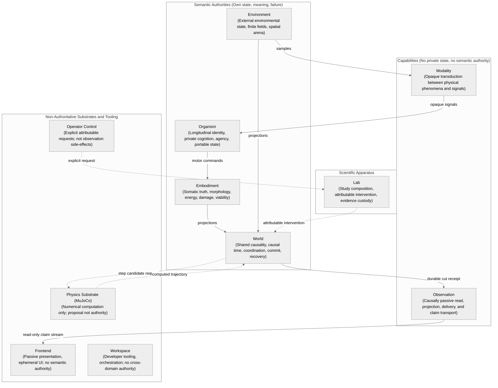
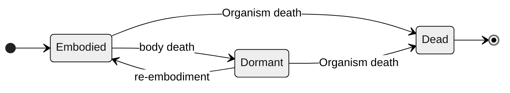
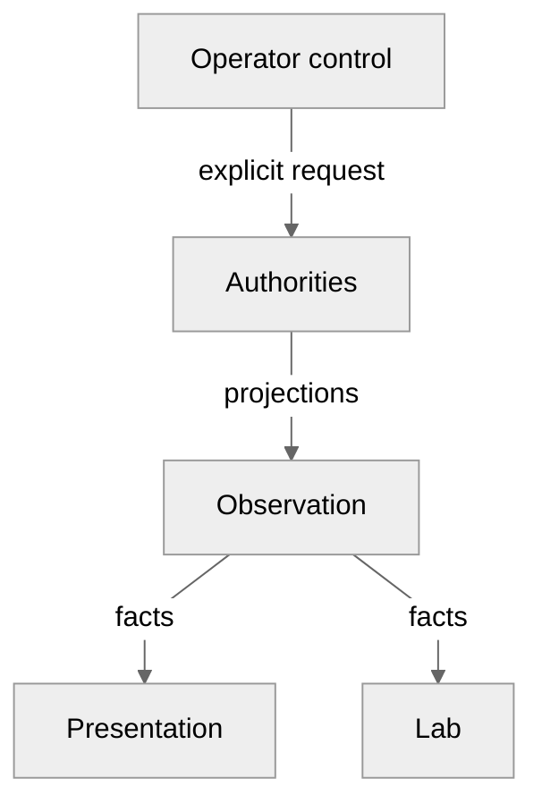

# What Biopeia is

This document is derived. It states nothing of its own: every statement comes
from an accepted decision record, linked where it is used, or from the
project's public statement of purpose. Where the two differ the decision
record is right.

It describes what has been **decided**. It does not describe what the code
does: a decision is accepted architecture, and the code is not claimed to
implement it. What exists in code today is told link by link in
[One step across the domains](one-step-across-the-domains.md), and the two
should be read together.

## The question

Biopeia is a research project in artificial life. Its public statement
(`profile/README.md` in the organisation's `.github` repository) puts the
question this way:

> What can an artificial organism come to learn, understand, and do when its
> capabilities develop from its own experience?

The same statement says what the project is not claiming. Its implementations
are research instruments, not evidence of biological equivalence,
consciousness or general intelligence, and a capability is not assumed to
exist because a software component with that name has been written.

That statement predates the decisions below in two places: it calls World and
Observation boundaries "under evaluation" and the division into repositories
unratified. Both have since been decided, in
[ADR-0095](../../technical/adr/ADR-0095-surviving-semantic-authorities.md) and
[ADR-0110](../../technical/adr/ADR-0110-repository-consequence-and-dependency-direction.md).

## Names

The project is Biopeia. The individual it studies is an Organism
([ADR-0085](../../technical/adr/ADR-0085-project-identity-is-biopeia-and-the-individual-is-organism.md)).
The name the individual carried in the source repository is not a name of
either.

## Who owns what

Boundaries are drawn from who owns meaning, state, causality and failure, and
only then from where code lives
([ADR-0075](../../technical/adr/ADR-0075-authority-boundaries-derive-from-semantic-ownership-not-repository-topology.md)).
Seven repositories are therefore not seven authorities: there are four
authorities, two capabilities and one apparatus (ADR-0110).

| Area | What it is | What it owns or does | Decided in |
|---|---|---|---|
| Organism | Semantic authority | Longitudinal identity, private cognition, memory, learning, private models, agency, competence, regulation, the origin of reproduction, and its own portable state | ADR-0095 |
| Embodiment | Semantic authority | The truth of one concrete body and episode: morphology, energy, damage, integrity, viability | ADR-0095, [ADR-0094](../../technical/adr/ADR-0094-somatic-state-ownership-body-holds-organism-regulates-and-feels.md) |
| Environment | Semantic authority | External environmental state and what it means | ADR-0095, [ADR-0074](../../technical/adr/ADR-0074-biopeia-world-environment-authority-split.md) |
| World | Semantic authority | Shared causality: World identity, causal time, who is present, ordering, commit and recovery. It does not own the state of its participants | ADR-0074, [ADR-0097](../../technical/adr/ADR-0097-hybrid-world.md) |
| Modality | Contract and library | Transduction between phenomena and opaque signals or effectors; not what an Organism makes of them | [ADR-0099](../../technical/adr/ADR-0099-modality-contract-library.md) |
| Observation | Passive capability | Reads, projects, transports and records; has no authority to change what it observes | [ADR-0078](../../technical/adr/ADR-0078-observation-is-causally-passive.md), [ADR-0100](../../technical/adr/ADR-0100-observation-capability-and-evidence-custody.md) |
| Lab | Scientific apparatus | Composes studies, launches and supervises, intervenes explicitly, captures evidence. It has no authority over autonomous life | [ADR-0102](../../technical/adr/ADR-0102-lab.md) |

Two things that look like authorities are decided not to be. The physics
engine is a substrate that computes; whether a computed transition becomes
committed World state is World's decision
([ADR-0098](../../technical/adr/ADR-0098-physical-substrate-and-causal-integration.md)).
Pausing, stepping or injecting into a running system is operator control: an
explicit, attributable request to the authority concerned, never a side
effect of observing
([ADR-0101](../../technical/adr/ADR-0101-operator-control.md)).

## What the decisions fix

### An Organism is one individual over time

An Organism is longitudinal. Its identity survives a change of body, of
embodiment session, of World presence, of running process and of checkpoint,
when the operation continues that same Organism
([ADR-0081](../../technical/adr/ADR-0081-the-canonical-organism-is-longitudinal.md)).
It has at most one continuation that has not been terminated; a copy or a
branch is a new identity
([ADR-0091](../../technical/adr/ADR-0091-one-non-terminated-continuation-per-organism-identity.md)).

The Organism owns the meaning of its private state. World, Lab, Observation
and the host do not acquire that meaning by coordinating, running, observing
or storing it, and what an Organism's inner condition is reaches others as
signals or actions it emits, not by another authority reading its internals
([ADR-0092](../../technical/adr/ADR-0092-organism-owns-the-meaning-of-its-private-longitudinal-state.md)).
A portable checkpoint of an Organism carries everything needed to restore it;
one that refers to missing content is not a complete continuation
([ADR-0103](../../technical/adr/ADR-0103-portable-organism-state.md)).

Cognition may be undeveloped, inactive or suspended while its state is kept.
The record that says so claims nothing about whether any of it works, is
needed or could be done without
([ADR-0105](../../technical/adr/ADR-0105-cognition-structure.md)).

### A body is not the Organism

A body holds its own energy, integrity, damage, age and viability. They end
with that body and are not carried to another. The Organism holds what
outlasts a body: set points, priorities, what it has learned about need,
deprivation and recovery (ADR-0094).

What a body is and how it is calibrated in one episode belongs to Embodiment.
What an Organism has learned about bodies belongs to the Organism.
Re-embodiment may make a learned competence unusable for a time; it must not
silently erase it
([ADR-0104](../../technical/adr/ADR-0104-body-schema-and-competence.md)).

The death of a body, the dormancy of an Organism, the end of its presence in
a World, the death of the Organism, re-embodiment, the death of an offspring
and the end of a lineage are seven different events. A body that is no longer
viable ends that body, not by that fact the Organism
([ADR-0088](../../technical/adr/ADR-0088-lifecycle-event-ontology.md)).

The Organism through the death of a body, as decided in ADR-0088. Embodied:
in one body, for one episode. Dormant: the same Organism with no active body.
Dead: the identity cannot resume. Not every
body death is recoverable, and Organism death is resolved under an explicit
contract; World may not infer it from a body dying, a process stopping, a
missing checkpoint or an administrative removal. The end of a presence in a
World, the death of an offspring and the end of a lineage are further,
separate events that the diagram leaves out.

### Everything shared happens in a World

Every embodied Organism that is causally active takes part in a World, even
alone. A World of one may be thin, but it has an identity, causal order, a
commit, a presence and a recovery boundary
([ADR-0096](../../technical/adr/ADR-0096-world-participation-including-singleton.md)).
World is neither a message router nor the owner of everyone's state: it owns
shared causal coordination and commit, and each authority keeps its own state
(ADR-0097). A World's identity is an identifier, never a display name
([ADR-0080](../../technical/adr/ADR-0080-world-identity-is-authoritative-not-a-presentation-label.md)),
and a World goes on without Lab unless it is explicitly ended
([ADR-0079](../../technical/adr/ADR-0079-world-lifecycle-is-independent-from-lab.md)).

### Causality is explicit

Each material causal cycle has a working transition, a resolution and a
commit. A failure before commit must not publish a complete transition
([ADR-0083](../../technical/adr/ADR-0083-causal-cycles-have-explicit-commit-semantics.md)).
After such a failure the runtime is in a durable state that requires
recovery, and ordinary execution cannot simply resume on a later tick;
restarting is not recovery
([ADR-0093](../../technical/adr/ADR-0093-material-failure-before-commit-requires-explicit-recovery.md)).

The clock of the host machine is never an implicit cause. Causal times are
explicit and distinct
([ADR-0090](../../technical/adr/ADR-0090-host-wall-clock-time-is-never-implicit-causal-authority.md)).
State shared and persistent has one writer, or explicit coordination between
writers
([ADR-0084](../../technical/adr/ADR-0084-single-writer-or-explicit-coordination-for-shared-persistent-state.md)).

Each authority defines its own checkpoint. World owns the coherent cut across
them and a manifest that names what the cut consists of
([ADR-0106](../../technical/adr/ADR-0106-hybrid-multi-owner-persistence.md)).
The journal of events is causal and evidentiary history and may help
recovery; it is not decided to be the only authority over state
([ADR-0107](../../technical/adr/ADR-0107-journal-role.md)).

### Looking does not touch

Observation is causally passive. It may read, project, transport, buffer,
aggregate, visualise and record, and it has no authority to change the causal
state it observes (ADR-0078). Projecting state at run time, carrying and
presenting it, and keeping durable scientific evidence are three separate
things; the last belongs to the scientific apparatus (ADR-0100).

How looking and intervening are kept apart, as decided in ADR-0078, ADR-0100
and ADR-0101. The authorities are Organism, Embodiment, Environment and
World; each projects its own state. Observation is passive, and Lab keeps
the durable evidence. No arrow leaves Observation towards an authority: a
request to pause, step or inject is operator control, goes to the authority
concerned, and World validates and commits it.

### Reproduction belongs to life

Reproduction in an ecosystem is endogenous. A birth triggered by Lab is not
that; Lab may cause one only as an explicit experimental intervention. A
mechanism of reproduction, endogenous reproduction, population dynamics,
selection and evolution are kept distinct
([ADR-0082](../../technical/adr/ADR-0082-canonical-reproduction-is-endogenous-to-life.md)).
The Organism originates it; World coordinates, validates and commits;
Environment and Embodiment supply conditions and limits
([ADR-0087](../../technical/adr/ADR-0087-organism-originates-ordinary-reproduction.md),
[ADR-0108](../../technical/adr/ADR-0108-reproduction-and-causal-entropy.md)).
A technical ceiling on population is a limit of the apparatus and must be
visible as one; it is not a law of ecology
([ADR-0109](../../technical/adr/ADR-0109-population-capacity.md)).

### The past is evidence, not obligation

Decision records of the source repository do not bind Biopeia by having once
been accepted
([ADR-0089](../../technical/adr/ADR-0089-standing-of-historical-adrs-for-the-target-architecture.md)).
Scientific provenance and the evidence needed to reproduce or interpret past
results may have to be kept; that does not oblige new code to stay compatible
with old
([ADR-0076](../../technical/adr/ADR-0076-preserving-scientific-meaning-without-backward-compatibility.md)).

## What this does not say

Nothing here says that Biopeia works. These are decisions about what the
system must be, most of them constitutional. Whether code implements a
decision, whether a test covers it, and whether any behaviour has been
observed are three further questions, answered unit by unit in the rest of
this documentation and summarised in
[One step across the domains](one-step-across-the-domains.md).
