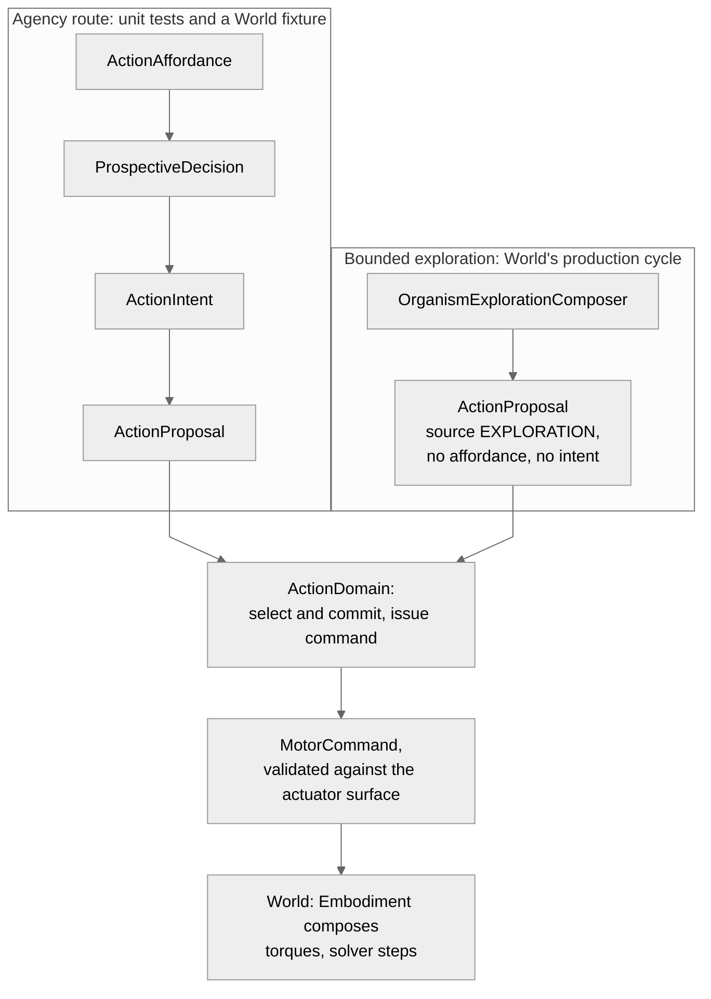

# From an affordance to a motor command

Reviewed against `organism` at commit
`637bc21a7e2a1aa9e0870f55f134e839657687f4` (main on 2026-10-16); first written against `ba001179`.
The action composition is exercised by World's sensorimotor causal cycle and
acceptance tests (`world@d66ac6197c8ea8489dc4f2689641ff0a88b6482a`). Statements are marked by what supports them: code, tests, or
an accepted decision.

## What it is

Before anything moves in a body, the Organism has to produce a value that says
how much to apply on which channel. This document follows how such a value, a
motor command, comes to exist in the Organism package, starting from the
earliest record that something could be done at all.

The package provides records and primitives, plus explicit execution
coordinators: `ActionDomain`, the canonical action pipeline
(`organism:src/organism/actuation/pipeline.py`), and bounded motor exploration
(`organism:src/organism/actuation/bounded_action.py::OrganismExplorationComposer`).
It can materialise an admitted decision as an intent, arbitrate and register a
commitment, issue a command through a controller, validate it against an
actuator surface, and close the action with a supplied terminal outcome. It
does not itself move a body: physical effects remain in Embodiment and a
solver.

The names of the records (affordance, intent, proposal, commitment) are taken
from the code. They are used here as names of data structures. This document
describes the operations performed on them and does not claim that an Organism
intends, decides or knows anything in a wider sense; nothing reviewed here
would support such a claim.

**Production execution context:** `ActionDomain` joins these steps within an
explicit execution context. In production, `world:src/world/causal_cycle.py`
and `world:src/world/organism_transition.py` construct and drive this context
via `OrganismExplorationComposer` and `OrganismCheckpointContract`, validating
actuator applicability and surface fingerprints across ticks and restarts
(`world:tests/integration/test_end_to_end_causal_cycle_acceptance.py`).

## The six steps at a glance

```text
ActionAffordance ──admit──▶ ProspectiveDecision ──copied by caller──▶ ActionIntent
                                                                          │ id only
ActionProposal ◀──────────────────────────────built by caller────────────┘
      │ arbitrate
      ▼
ArbitrationDecision ──read by caller──▶ ActionCommitment
                                              │ controller
                                              ▼
                                       ControllerFrame ──bind──▶ MotorCommand
```

The coordinator owns admission-to-intent consistency, arbitration and
commitment registration, and command issue/execution. Proposal construction,
controller selection and the physical transition remain explicit inputs or
boundaries outside that coordinator.

### Two routes into the coordinator

A proposal reaches `ActionDomain` by one of two routes, and only one of them
starts from an affordance.



Bounded exploration builds its own proposal with source `EXPLORATION`, no
competence and no affordance. It commits that proposal for one tick and
issues the command through the same coordinator. It refuses to run while a
commitment backed by an intent is in force
(`organism:src/organism/actuation/bounded_action.py`, "exploration cannot
replace an active intention commitment"; same code at `de16558` and at
`637bc21a7e2a`). The production cycle therefore exercises the coordinator's
arbitration, commitment and command issue, but not the route from an
affordance. What the Organism hands on is the command; turning it into
torques and moving the body happen in World, through Embodiment's mapping and
the solver ([the causal cycle](../world/causal-cycle.md)).

## Step 1: an affordance

An affordance (`organism:src/organism/agency/affordance.py::ActionAffordance`)
is an immutable record naming a competence, an effect expected from it, an
optional context and embodiment, three numbers between zero and one
(prediction confidence, controllability, executability confidence) and
references to supporting evidence. The module describes its content as "this
competence appears executable now and is expected to produce this Effect in
this situation" and its status as "never checkpointed, without lifecycle,
without motor authority and without actuator semantics".

The record enforces the last of these in one narrow way: an evidence reference
that begins with `actuator.`, `motor.` or `channel.` is refused. The numbers
must lie in the unit interval. Nothing else is checked; in particular the
record does not know whether the competence it names exists.

The package contains a resolver that derives affordances from competence,
prediction, controllability and binding state
(`organism:src/organism/agency/affordances.py::AffordanceResolver`). It is not
constructed anywhere in the repository, in source or in tests, and it was not
exercised for this document. In the fixture the affordance is written out by
hand with constant values.

## Step 2: admission

Admission (`organism:src/organism/agency/prospective.py::admit_afforded_action`,
described by its own docstring as "Model-free executive admission of one
currently afforded competence.") takes a collection of affordances and returns
at most one decision. It is a pure function: it holds no state and changes
none. What it computes is arithmetic, and it is worth stating exactly.

1. **Which affordances are considered.** An affordance is a candidate if the
   caller supplies, for its competence, a finite number at or above the
   policy's readout threshold (0.1 by default). The size of that number beyond
   the threshold plays no further part. Affordances supplied through the
   second, "generative" argument are candidates without any readout.
2. **Relevance.** For each candidate two numbers are formed. The first is the
   larger of a caller-supplied epistemic value and one minus the affordance's
   prediction confidence. The second is a caller-supplied homeostatic
   relevance. Relevance is the larger of the two.
3. **History.** If the caller supplies a history callback, a candidate it
   reports as suppressed is dropped, and otherwise relevance is multiplied by
   the factor it returns. The intended source of that callback is the
   [executive outcome ledger](executive-outcome-ledger.md).
4. **Threshold and choice.** Candidates whose relevance is below the policy's
   minimum (0.2 by default) are dropped. Of the rest, the one with the highest
   relevance is returned; ties are broken by controllability, then prediction
   confidence, then the generative route, then the competence identifier.

Two consequences follow from the arithmetic and were confirmed by running the
function. Because relevance is at least one minus the prediction confidence,
a *less* predictable affordance outranks a more predictable one when nothing
else differs: of two candidates with prediction confidence 0.9 and 0.1, the
second was returned, and a single candidate with prediction confidence 0.9 and
no other relevance was not admitted at all. And the affordance's executability
confidence is not read: a candidate with executability confidence zero was
admitted.

The tests cover the conditions of admission:
`test_primitive_readout_alone_does_not_form_intent`,
`test_readout_plus_affordance_without_executive_admission_does_not_form_intent`,
`test_readout_plus_affordance_plus_admission_can_form_intent`,
`test_inactive_readout_is_not_represented`,
`test_homeostatic_relevance_can_admit_a_predictable_competence` and
`test_generative_anticipation_is_a_representation_route`. Despite the word
"intent" in their names, these tests exercise the function's return value; no
intent record is created in them.

The result (`ProspectiveDecision`) repeats the affordance's competence, effect
and prediction reference, carries the two relevance numbers, and lists where
it came from: a readout reference and the affordance identifier.

## Step 3: an intent

An intent (`organism:src/organism/agency/intention.py::ActionIntent`) is the
first mutable record on the path. It holds what the decision held, three
ticks (created, activated, last progress), a status and, once ended, a reason.

The status is a small state machine and is the whole of the record's
behaviour:

```text
PENDING ──▶ ACTIVE ──▶ SATISFIED | FAILED | INTERRUPTED | INVALIDATED
   └──────▶ REJECTED | INVALIDATED
```

Moving to any ending status requires a reason; no status can be left once it
is an ending one. Confirmed by running the module: a pending intent cannot be
marked satisfied, an active one cannot be activated again, a failed one cannot
be reactivated.

The record refuses a competence or an origin reference that begins with
`actuator.`, `motor.`, `channel.`, `joint.` or `controller.`. Its module says
of it: "It has no motor authority; only the ActionArbitrator grants that,
through an ActionCommitment." That sentence describes a design. What the code
establishes is narrower and is set out under
[what the path does not establish](#what-the-path-does-not-establish).

What is not checked, confirmed by running the module:

- **That an intent came from an authentic admission.**
  `ActionDomain.admit()` materialises the supplied decision as an intent and
  checks that its competence and origin are consistent with the supplied
  supporting affordance. The standalone intent constructor remains
  permissive: an intent naming a competence absent from any affordance or
  decision can still be constructed directly. The coordinator also does not
  authenticate the affordance's provenance; see
  [what the path does not establish](#what-the-path-does-not-establish).
- **That an intent starts pending.** One can be constructed already active.
- **The order of ticks on activation.** An intent created at tick 5 was
  activated at tick 2.

An intent can be exported to a plain mapping and restored from one, and the
round trip returned an equal record. The domain tests exercise materializing
and transitioning an intent, but the record's serialization and standalone
permissive construction observations above are not a complete dedicated
intent-record test suite.

## Step 4: a proposal and its arbitration

A proposal (`organism:src/organism/actuation/action.py::ActionProposal`) is an
immutable request. It names a source, one of exploration, competence,
prospection, protection and regulation, optionally a competence, an effect
and an intent identifier, and carries an evaluation: up to eight numbers in
the unit interval, which the code describes as "Vector-valued evaluation;
deliberately not a scalar reward." A proposal from the exploration source may
not carry an intent, and one that carries an intent must name a competence.

The arbitrator
(`organism:src/organism/actuation/arbitration.py::ActionArbitrator`) receives
a set of proposals, optionally the commitment currently in force, and a tick,
and returns one of the proposals or none. It holds no state. Its rule is an
order of precedence between sources rather than a weighted sum, read from the
code and confirmed by running it:

1. Proposals whose estimated risk is 1.0 are discarded.
2. If any remaining proposal is from the protection source with a protective
   relevance above zero, the highest of these is returned. This happens even
   when a commitment is in force and has not reached its minimum duration.
3. Otherwise, if a commitment is in force and has not reached its maximum
   duration, nothing is returned and the commitment is to be kept. A
   commitment without a maximum duration is kept at every tick: with one in
   force, three ordinary proposals were refused at tick one million.
4. Otherwise proposals from the prospection or competence source that name a
   competence take precedence over all others, whatever the numbers: a
   proposal of that kind with effect confidence 0.01 was returned ahead of a
   regulation proposal with homeostatic relevance 1.0 and an exploration
   proposal with epistemic relevance 1.0.
5. Then regulation, then exploration, then whatever remains by identifier.

The arbitrator returns a decision and a reason string. **It does not create,
alter or end a commitment.** `ActionDomain.select_and_commit()` supplies the
currently registered commitment, validates a selected proposal against a
registered pending intent, creates and registers one commitment, and
interrupts the previous commitment and intent when replacing them. The domain
keeps this context in memory; no checkpoint/restore contract is provided
here. The arbitrator's precedence rules remain as described above; its
standalone behavior and the coordinator path have tests in
`organism:tests/source_unit/actuation/test_domain.py` (the arbitrator itself
remains separately untested).

## Step 5: a commitment

A commitment
(`organism:src/organism/actuation/commitment.py::ActionCommitment`) is the
second mutable record. It names a proposal, optionally an intent, a
competence and an effect, the tick at which it started, a controller, the
fingerprint of an actuator surface and optionally an embodiment. Its status
begins as active and can be ended once, with a tick and a reason; a second
attempt to end it is ignored without error.

It can answer whether it is compatible with a given surface fingerprint and
embodiment, and it can be exported and restored with a strict check of the
field set (the round trip was confirmed by running it).

The commitment is where the sentence quoted in step 3 would have to be
enforced, and the code does not enforce it. Confirmed by running the module:

- A commitment naming a proposal identifier that never existed, and an intent
  identifier that never existed, was constructed and was active.
- Two active commitments were held at once. Nothing in the package records
  which commitment, if any, is the one in force; the arbitrator is told by its
  caller.

## Step 6: a controller frame and the command

A controller
(`organism:src/organism/actuation/controller.py::SequenceController`) holds a
fixed sequence of steps, each a set of pairs of actuator identifier and
activation, and a position in that sequence. Asked for a frame under an active
commitment whose controller identifier matches its own, it returns the
current step and advances; after the last step it returns the last step again
at every call. An empty sequence yields a frame with no channels.

The controller's position is the only state on the path that is neither
exported nor restorable: the class has no checkpoint. The tick it is given is
stamped on the frame and compared only with the commitment's start; frames for
tick 2 and then tick 1 were both produced, each advancing the position.

A frame is not yet a command. `ActionDomain.issue_command()` obtains a frame
under its registered active commitment and calls
`organism:src/organism/actuation/command.py::motor_command_from_frame`. It
refuses an inactive commitment, a frame from another controller, commitment or
competence, a tick that is not an integer, precedes the commitment or differs
from the frame's
(`test_active_organism_commitment_binds_frame_to_explicit_causal_tick`,
`test_binding_rejects_frame_from_another_controller_or_competence`,
`test_binding_rejects_inactive_commitments_and_ticks_before_start`,
`test_binding_requires_explicit_integer_tick`,
`test_binding_rejects_frame_from_another_commitment_and_tick`).

Its own description of its limits is accurate: "It does not validate an
actuator surface, execute the command, or mutate the commitment/controller."
A frame naming an actuator that belongs to no surface was bound into a
command. The command identifier is supplied by the caller and is not checked
for reuse: two different identifiers were issued for one frame.

The result (`organism:src/organism/actuation/action.py::MotorCommand`) is an
immutable value: its own identifier, the commitment, controller and competence
it came from, a surface fingerprint, an optional embodiment identifier, a tick
and the channels. Each channel is an actuator identifier with an activation in
the unit interval; an identifier may appear once.

## The actuator surface

The channels of a command are named against an actuator surface
(`organism:src/organism/actuation/surface.py::ActuatorSurface`): a list of
channels, each with an opaque identifier, a legal range inside the unit
interval, a neutral value and an availability flag, together with a
fingerprint of the whole. The module states the intent: "The surface states
only which opaque commands are legal." Nothing about what a channel does is
present, and `test_surface_exposes_only_legal_command_contract` checks that
some such fields are absent.

How the identifiers are made matters, and it changed. When this document was
first written an identifier was a hash of the channel's position in the list,
so two bodies shared their first identifiers and a list of reordered physical
ports gave an equal surface. That was recorded as a finding and has since been
fixed in the repository.

At the revision reviewed a surface is built from effector identifiers
supplied by the caller. Read from the code and confirmed by running it:

- An actuator identifier is the effector identifier it was given, kept
  verbatim (`test_effector_ids_are_unique_and_preserved_verbatim`). Empty or
  repeated identifiers are refused, and a single string is not taken for a
  sequence (`test_scalar_string_is_not_treated_as_sequence_of_effector_ids`).
- The order in which the identifiers are supplied does not change the
  fingerprint: the same identifiers in another order give the same
  fingerprint, and each keeps its own identifier
  (`test_effector_identity_is_stable_when_input_order_changes`).
- Building a surface from a count alone is no longer possible
  (`test_positional_count_construction_is_not_supported`).
- Contract material changes the fingerprint and not the identifiers
  (`test_contract_metadata_changes_fingerprint_not_effector_identity`).

So an actuator identifier now names an effector, not a place in a list. What
the surface still cannot tell is whose effectors they are: two surfaces built
from the same effector names and the same contract material are equal,
whichever body they were built for. The names are supplied by whoever builds
the surface; nothing in Organism obtains them from Embodiment.

The package also contains a class
(`organism:src/organism/actuation/system.py::ActuatorSystem`) that checks a
command against a surface: same fingerprint, every channel present, available
and in range. It returns, per channel, the requested and the delivered value,
which are always equal (`test_system_rejects_channel_outside_surface`,
`test_system_rejects_command_for_another_surface`). It is described in the
code as handing a command "across the opaque body boundary"; what it does is
validate and return. It has no knowledge of commitments: a command naming a
commitment that was never created was accepted. The World fixture does use it
to validate the command against the surface and obtain delivered channel
values before projecting those values into Embodiment.

## Time

No step on the path reads a clock, and the Organism package has none. Every
tick in every record, created, activated, started, generated, issued, is a
number handed in by the caller. The command binding insists that the issuing
tick equal the frame's tick and not precede the commitment; beyond that,
nothing relates the ticks of one record to those of another, and nothing
relates any of them to World's causal tick except the caller's choice to pass
that number in.

## What the path does not establish

- **That a command descends from an authentic admission.** Within one
  `ActionDomain`, intent and commitment references are checked against its
  registered state. `admit()` still cannot authenticate caller-provided
  provenance; its docstring assigns that guarantee to the canonical
  cognition/admission composition. Outside the coordinator, records remain
  independently constructible.
- **That its in-memory registration survives restart.** The reviewed
  `ActionDomain` has no checkpoint/restore contract.
- **That a physical effect occurred.** `execute()` checks the command against
  the surface and returns requested/delivered actuation values; Embodiment and
  the solver determine physical effects. The coordinator does not construct
  an `ActionAttempt` in this path.
- **That observed outcomes are fed back automatically.** `close()` can end an
  active action and can record a supplied, validated non-neutral outcome in a
  supplied outcome ledger. It does not infer or observe outcomes; the caller
  must provide them. This capability does not establish a production
  feedback loop.
- **Anything about cognition or learning.** In the only composition that
  exists, every input is a constant: the affordance is written by hand, the
  readout is the literal 0.9, the epistemic and homeostatic callbacks return
  nothing and zero, and the controller's sequence is one fixed step. The
  fixture says as much of itself.

## The one composition: World's physical step fixture

The fixture builds a surface of two channels, one affordance with prediction
confidence 0.4, and admits it (relevance 0.6 against a minimum of 0.2). It
passes the decision and supporting affordance to `ActionDomain.admit()`, builds
one proposal from the prospection source, and passes it to
`select_and_commit()`. The domain registers the commitment and activates the
corresponding intent. A controller has one step that drives the first channel
at 0.5.
Inside the World transition it asks the controller for a frame and binds it
into a command for the tick being committed.

From there the command leaves the Organism package. Embodiment projects it
onto effectors using a mapping from actuator identifier to effector that the
fixture itself writes down, and a solver is stepped. The fixture introduces
the Organism part with the comment "This exercises the target-native admitted
action path from an explicit," and continues that it is a deterministic
readout and no claim of cognition; it calls the controller "only the
low-level" controller, and says of the outbound path "Modality is not in this
outbound path".

The Organism's state in that fixture is a small JSON document written by the
fixture, recording the identifier of the last command. It is not built from
any of the records above and does not use the Organism's
[checkpoint envelope](identity-and-checkpoint.md). That the organism
checkpoint there is a stand-in is already recorded as finding F-0002.

## Beside the decision on commands

[ADR-0073](../../technical/adr/ADR-0073-biopeia-migration-causal-and-physical-contracts.md)
fixes two contracts that bear on a command. They are set beside the code here
without a ruling on conformance; the decision addresses Embodiment commands,
and the Embodiment side was not reviewed.

| The decision says | The Organism code at this revision |
|---|---|
| "Omission is not a command." An omitted channel "does not imply zero or neutral." | A command lists only the channels the controller named. The surface check returns results only for those, and an empty command yields an empty result. In the fixture one of two channels is commanded and the comment reads "the missing right channel remains NO COMMAND". Every surface channel nevertheless carries a neutral value, 0.0 unless set otherwise; nothing reviewed here applies it. |
| A command is bound to `body_id`, `embodiment_episode_id`, `morphology_revision`, `effector_id` and `command_kind`. | A motor command carries a surface fingerprint, an optional embodiment identifier and opaque actuator identifiers. It has no body, morphology revision, effector or kind. In the fixture those are supplied at Embodiment's projection. |
| "Array/list position is never authoritative." | An actuator identifier is the effector identifier supplied when the surface is built; the order of the list does not enter the identifier or the fingerprint. |
| Public APIs have no implicit units; the effector descriptor defines the valid range. | An activation is a bare number required to lie between zero and one. |

[ADR-0095](../../technical/adr/ADR-0095-surviving-semantic-authorities.md)
assigns agency and competence to the Organism, and
[ADR-0092](../../technical/adr/ADR-0092-organism-owns-the-meaning-of-its-private-longitudinal-state.md)
says internal conditions are exposed outward as Organism-emitted signals or
actions. A motor command is the only outward value on this path. Those are
statements of intent; this document does not test them.

## Compact ActionDomain checkpoint with external history (M3)

Full `ActionDomain.checkpoint()` exports every commitment and intent ever registered,
growing $O(N^2)$ over extended runs. To address this, `organism:docs/action-history/m3-specification.md`
and `organism:src/organism/actuation/action_history.py` establish a compact checkpoint format
with external content-addressed history segments:

- **History segments:** An immutable, content-addressed chain of JSON segments
  (`schema: "biopeia-organism-action-history-segment-v1"`), linked by SHA-256 digests
  (`previous_head`). Terminal commitments, intents and closures are appended to segments.
- **Compact domain state:** `ActionDomain` serializes only live commitments and pending/active
  intents (`schema: "biopeia-organism-action-domain-compact-v1"`), retaining $O(1)$ size
  with respect to run length.
- **Retired identity tracking:** On restore, `ActionDomain.restore_live` populates
  `_retired_intent_ids`, `_retired_commitment_ids` and `_retired_closed_ids` from the verified
  history chain, preserving registration uniqueness and double-close prevention without keeping
  historical record bodies in memory.
- **Exploration checkpoint v5:** `exploration_checkpoint_v5` packages the compact domain state
  into an envelope (`schema: "biopeia-organism-exploration-checkpoint-v5"`) and declares an
  explicit external dependency (`declared_dependency(locator=..., sha256=head_sha256)`).
  Restoring loads the historical segment chain backward to genesis via a caller-supplied resolver
  and verifies each link and count before restoring the domain
  (`test_exploration_v5_round_trips_exact_domain_state`, `test_load_history_rejects_broken_chain`).
- **Production integration:** In World's causal cycle (`world:src/world/causal_cycle.py`),
  `OrganismExplorationComposer` coordinates step persistence, linking history segments into
  World's content-addressed dependency storage before committing the causal cut
  (`world:tests/integration/test_end_to_end_causal_cycle_acceptance.py`).

## What supports this description

| Claim | Support |
|---|---|
| Conditions under which admission returns a decision | Code and tests in `organism:tests/source_unit/agency/test_executive_admission.py` |
| A less predictable affordance outranks a more predictable one; executability confidence is not read; readout size beyond the threshold is not used | Code, and one ad hoc run of the module at that revision; no test is kept for it |
| The intent state machine and permissive standalone construction | Code and ad hoc run; `test_domain.py` additionally covers coordinator admission and transitions, not every standalone construction case |
| The arbitrator's order of precedence, that it holds no state and does not end a commitment | Code and ad hoc run; `ActionDomain` tests exercise its selected-path composition, but there is no dedicated arbitrator test module |
| A commitment needs no arbitration; two can be active at once | Code and the same ad hoc run |
| What the command binding refuses | Code and tests in `organism:tests/source_unit/actuation/test_command_binding.py` |
| Controller repeats its last step, accepts repeated and decreasing ticks, has no checkpoint | Code and the same ad hoc run |
| Effector identity is stable under input reordering; contract changes affect fingerprint, not identity | Code and tests in `organism:tests/source_unit/actuation/test_surface.py` |
| What the surface check accepts and refuses | Code and tests in `organism:tests/source_unit/actuation/test_system.py`; the acceptance of a command with no commitment from the ad hoc run |
| `ActionDomain` admission, commitment registration, command issue/execution and terminal close/outcome recording | Code in `organism:src/organism/actuation/domain.py` and tests in `organism:tests/source_unit/actuation/test_domain.py` |
| Compact ActionDomain checkpoint round-trips live state and tracks retired record identities | Code in `organism:src/organism/actuation/action_history.py` and tests in `organism:tests/source_unit/actuation/test_action_history_prototype.py` |
| Exploration checkpoint v5 declares external history dependency and restores via backward segment verification | Code in `organism:src/organism/actuation/action_history.py` and tests in `organism:tests/source_unit/actuation/test_exploration_v5.py` |
| Production causal cycle integration via `OrganismExplorationComposer` | Code in `world:src/world/causal_cycle.py` and tests in `world:tests/integration/test_end_to_end_causal_cycle_acceptance.py` |
| The composition in the fixture, including domain-coordinated intent and commitment | Code of `world:tests/integration/physical_step/test_first_biopeia_physical_causal_step.py` |
| What a command must be bound to, and that omission is not a command | Accepted decision ADR-0073; a statement of intent |

## Open questions

- Whether the controller's position belongs in the Organism's checkpoint. In
  the fixture the Organism state names a controller and an initial step, and
  no code reads them back.
- Whether the Organism-side surface check and Embodiment's projection are both
  meant to stand, and which of them is the body boundary.
