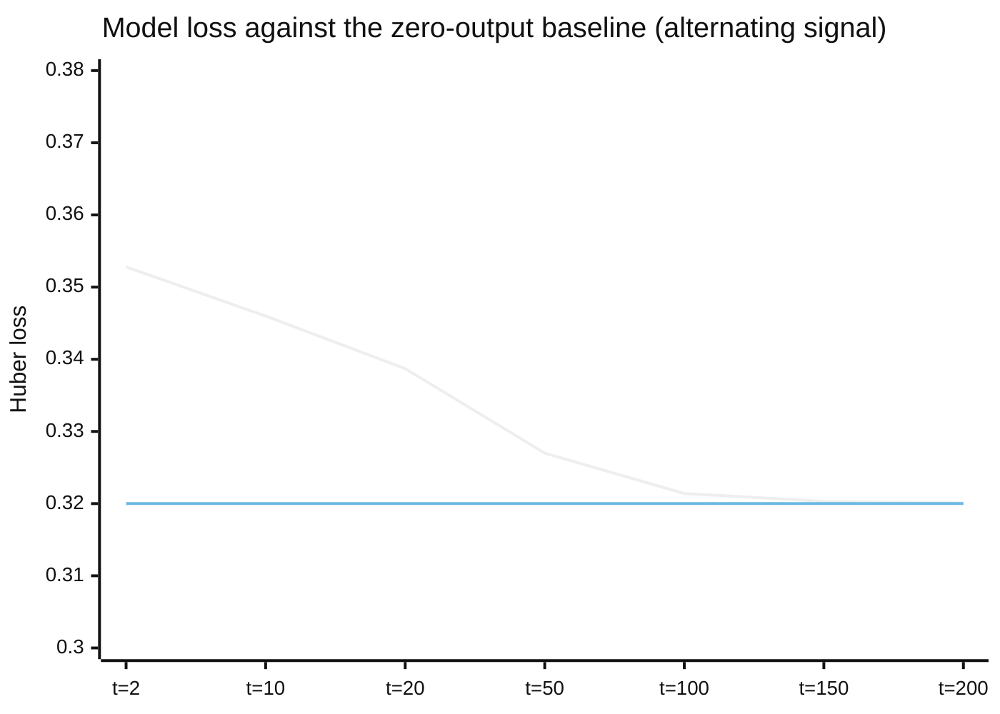

# How the cognitive graph is changed

Reviewed against `organism` at commit `ba0011797a6a3b4d48c7731651e50560c4043f18`.
Everything below describes that revision. Statements are marked by what
supports them: the code, the tests, an ad hoc run, or an accepted decision.
Searches were repeated on 2026-10-11 over the source of all seven
repositories.

## What it is

[The cognitive graph](cognitive-graph.md) computes; it does not change. This
document covers the functions that can change it: rules that move the weight
of an edge, rules that add and remove edges and nodes, and two small values
meant to restrain those rules.

The first thing to say about them is where they sit. They are a set of
separate functions and counters, and at the earlier revision no code in the
repository called any of them. That has changed for three of them and for
nothing else.

**The three weight functions now have one caller in source.** A composition
function calls the graph transition, then `compute_prediction_errors`, then,
for each edge a caller names, `update_eligibility` and `apply_oja_update`. It
is described in
[from an opaque sense signal to an accepted step](sense-to-checkpoint-transition.md#the-composition).
Its own description limits it: it "does not create graph structure, invent
learning parameters, publish actions, or claim to be a complete Organism
transition." The learning rate, the modulation and the gate are arguments.
The function that calls the composition for a checkpointed Organism has no
caller in the source of any repository, and nothing in source constructs the
argument that names an edge to update.

**Everything else here still has no caller.** Search of the source of the
seven repositories on 2026-10-11 for `StructuralPlasticity`,
`propose_concept`, `apply_mutations`, `evaluate_edge_lifecycle`,
`advance_edge_age`, `MetaParameter`, `record_failure` and the three shadow
prediction classes: each is defined in `organism:src`, none is called or
constructed outside its own module, and the other six repositories do not
mention them. (`ShadowPrediction` is re-exported by the package and
`SafetyState` is constructed by the checkpoint codec.) Wherever one of these
runs, a test is running it.

So this document still does not describe how an Organism learns. It describes
pieces from which a learning loop could be assembled, one function that now
assembles three of them under a caller's parameters, what each piece computes
when called, and exactly what the tests of each piece show. The repository
states the same boundary about the code it copied: "No efficacy claim is
implied." [ADR-0105](../../technical/adr/ADR-0105-cognition-structure.md)
states it about the architecture: "This establishes no scientific efficacy,
necessity, dispensability or viability claim."

## Changing a weight

Three functions in `organism:src/organism/cognition/learning.py`.

**A comparison called prediction error.** For every node of kind predictor,
`compute_prediction_errors` subtracts the predictor's value in the previous
frame from the current value of the node it names, and attaches a Huber loss
of that difference. A predictor with no previous value is skipped
(`test_exact_prediction_yields_zero_error`,
`test_mismatched_prediction_yields_nonzero_error`,
`test_cold_start_predictor_missing_from_previous_is_skipped`). The function
returns numbers. It changes nothing.

**A trace called eligibility.** `update_eligibility` replaces an edge's
`eligibility` with a decayed copy plus the product of the source's previous
value and the target's current value, clipped to [-10, 10]
(`test_eligibility_grows_with_sustained_coactivation`,
`test_eligibility_stays_bounded_even_when_decay_is_exactly_one`). No other
function reads the field.

**The update.** `apply_oja_update` changes an edge's weight by

```text
learning_rate × modulation × (source × target − target² × weight)
```

and clips the result to [-2, 2]. This is Oja's form of a Hebbian rule: the
weight moves with the product of the two values and is pulled back in
proportion to itself. It does nothing if the caller passes `frozen`, passes
`eligible` as false, or passes a `modulation` of zero
(`test_oja_update_is_a_noop_when_frozen`,
`test_oja_update_is_a_noop_when_not_eligible`,
`test_oja_update_is_a_noop_when_modulation_is_zero`,
`test_oja_update_moves_weight_toward_correlated_activity`).

The function validates none of its inputs. Checked on 2026-10-16 at `organism`
`637bc21a7e2a1aa9e0870f55f134e839657687f4` in an ad hoc run that is not kept
as a test: the clip maps a NaN to the upper bound, so a non-finite learning
rate, modulation or activation sets the weight to 2.0 without error, and a
negative learning rate is accepted. Its one production caller passes values
that `EdgeLearningInstruction` has already checked to be finite, with a
non-negative rate. Recorded as finding F-0171.

Three things the signatures leave unconnected, read from the code:

- `eligible` is a boolean the caller supplies. The function does not look at
  the edge's `eligibility`. The trace and the gate share a word and nothing
  else.
- `modulation` is a number the caller supplies. The prediction error is not
  an argument. Whether an error scales an update is up to code that does not
  exist here.
- The edge's own `plasticity` field is not read.

The composition that now calls the three functions connects none of these.
It takes `eligible`, `modulation` and the learning rate from its caller, per
edge, and returns the prediction errors without using them
(`test_learning_without_action_linked_eligibility_does_not_change_weight`;
code of `organism:src/organism/cognition/composition.py`). Recorded as
finding F-0142.

### What the one end-to-end test shows

> Section updated on 2026-10-16 against `organism`
> `637bc21a7e2a1aa9e0870f55f134e839657687f4`, after organism#174; the rest of
> this document keeps the review revision stated at its top.

One test puts these together:
`test_alternating_signal_oja_loop_does_not_beat_zero_output_baseline`. Until
organism `b674450` (#174, for organism#44) its name said that a predictor
"measurably learns a periodic signal over many ticks", and it passed if the mean loss over the last 20 errors was lower than over the first
20.

The test builds a sense node, a predictor node naming it, and one edge between
them with weight 0.05. For 200 ticks it feeds a signal alternating between
+0.8 and −0.8, activates the graph, computes the prediction error, and calls
`apply_oja_update` with `learning_rate=0.05`, `modulation=1.0` and
`eligible=True`. Each error is scored against the causally subsequent target
before that tick's update. The test now passes only if the model's mean loss
is **higher** than that of a predictor that always outputs zero, the
persistence baseline is higher still, and the weight ends below 1e-3; its
comment says the loop "is not evidence of predictive learning". It no longer
calls `update_eligibility`.

The original loop was reproduced at `organism`
`6543188ff302a5f2dc8002c0086252d6061e5310`. The current test's loop was re-run
on 2026-10-16 at `organism` `0ce7a031b6e9ee79ecbf7905c69452a5567f2dd2`
(`learning.py` and the test are identical at `637bc21a7e2a`) and gives the
same first- and last-20 means. Over all 199 scored samples the model's mean
loss is 0.3252, against 0.3200 for zero output and 1.1000 for persistence, and
the weight ends at 7.7e-5. Result:

| | Value |
|---|---|
| Weight at the start | 0.05 |
| Weight after 200 ticks | 0.0001 |
| Mean loss, first 20 | 0.3451 |
| Mean loss, last 20 | 0.3201 |
| Loss of a predictor that always outputs 0 for this signal | 0.5 × 0.8² = 0.32 |



The upper line is the model's loss on the causally subsequent sample at the
ticks shown, and the flat line the zero-output baseline (0.32). Values come from
re-running the loop of
`test_alternating_signal_oja_loop_does_not_beat_zero_output_baseline` on
2026-10-16 at `organism` `0ce7a031b6e9ee79ecbf7905c69452a5567f2dd2`. The
persistence baseline, 1.1, is off the scale. The model approaches the
zero-output baseline from above and never goes below it.

The loss falls because the weight shrinks to zero. With a small positive
weight the predictor's output is a small copy of the current signal, which is
the opposite sign to the next one, so it is slightly worse than silence; the
Hebbian rule, seeing source and target anti-correlated, removes the weight.
The end state is a predictor that outputs approximately nothing. Predicting
this signal would require a negative weight, and the rule's fixed point here
is zero.

What the loop establishes is therefore: on an alternating signal, it drives a
mis-signed weight to zero and the loss falls by about 7 per cent to the level
of no prediction. It does not show a predictor coming to predict the signal,
and since #174 the test asserts exactly that. The error computed in the loop
is recorded and plays no part in the update; in the original analysis,
removing the call to `update_eligibility` gave the same numbers, and the
current test no longer makes that call.
For contrast, the same loop on a constant signal of 0.8 raised the weight to
1.11 and the late loss fell to 0.004; a constant is the case a Hebbian rule
fits. The constant-signal run is not kept as a test. Recorded as finding
F-0071, which stays open with organism#44: no test shows a predictor beating
a zero-output or persistence baseline.

## Candidates kept outside the graph

The same module holds three classes that the code calls shadow predictions.
Each accumulates two running losses over observations supplied by the caller:
the loss of a fixed guess, and the loss of guessing that the target repeats
its previous value. After 8 samples the status becomes "supported" if the
first is smaller and "contradicted" otherwise; after 16 a contradicted one
becomes "retired".

- `ShadowPrediction` guesses that the target equals the source's previous
  value (`test_shadow_prediction_requires_out_of_sample_gain`,
  `test_shadow_prediction_does_not_promote_without_gain`).
- `LaggedShadowPrediction` guesses that the target equals the source a fixed
  number of ticks ago, between 1 and 16
  (`test_lagged_shadow_prediction_learns_delayed_relation_without_graph_mutation`).
  The test feeds ten alternating values with the target defined as the source
  two steps back, and checks the status is "supported". Its docstring is
  careful: "This is deliberately not a causal claim and never mutates a
  ``CognitiveGraph``."
- `ComposedShadowPrediction` fits two slopes by least squares through the
  origin over a rolling window, source to intermediate and intermediate to
  target, and guesses the product
  (`test_composed_shadow_prediction_uses_two_learned_local_relations`,
  `test_composed_shadow_prediction_revises_second_relation_after_contradiction`).

Each exposes a property `promotable`. Nothing reads it: no function turns a
supported candidate into an edge or a node (search of `organism:src` for
`promotable`, 2026-10-11). The word "out-of-sample" in one test name refers to
nothing in the code; every sample is counted as it arrives. These classes are
also not part of any saved state.

## Changing the structure

In `organism:src/organism/cognition/structure.py`.

**Counting.** `StructuralPlasticity` keeps two tables of integer counts keyed
by a pair of node identifiers. One is incremented when the caller reports both
nodes "active"; the other when the caller reports a source active and an
actuator as having "effect evidence". What counts as active, and what counts
as evidence, is decided by the caller: the arguments are booleans
(`test_no_coactivation_never_reaches_support`,
`test_coactivation_does_not_record_a_sense_target`). The `tick` argument of
both methods is discarded.

**Proposing.** `propose` walks the counts in sorted order and emits a request
to add an edge for each pair whose count has reached a threshold, which is not
already joined, which fits under the ceilings, and neither of whose nodes was
part of a proposal within a cooldown
(`test_proposal_fires_once_minimum_support_reached`,
`test_already_connected_pair_is_never_reproposed`,
`test_proposal_withheld_when_kernel_edge_budget_exhausted`,
`test_pair_on_cooldown_after_a_proposal_is_not_reproposed_immediately`). Every
proposed edge is the same: kind excitatory, weight 0.05, delay 1.

**A node called a concept.** `propose_concept` takes two to four existing node
identifiers and returns a request to add one node of kind concept, named
`concept_` followed by 64 random bits in hexadecimal from a generator the
caller passes in, with a weight-0.05 edge from each of the given nodes
(`test_propose_concept_returns_an_add_node_mutation_with_opaque_id`,
`test_propose_concept_is_deterministic_for_the_same_seed`). That is the whole
of what "concept" means in this code: a node of that kind fed by a few others.
Which nodes to group is the caller's choice; the function does not look for
them.

**Applying.** `apply_mutations` applies a batch of requests and returns a new
graph, or the original graph if any request in the batch is invalid, if the
batch exceeds a per-call ceiling, or if `frozen` is passed
(`test_apply_mutations_produces_a_new_graph_containing_the_edge`,
`test_apply_mutations_silently_skips_a_rejected_mutation`,
`test_apply_mutations_is_a_noop_when_frozen`,
`test_remove_node_before_remove_edge_rejects_the_whole_batch`). Validity is
decided by building the candidate graph and seeing whether construction
accepts it. A refusal is silent: the caller receives the old graph and no
reason.

Five kinds of request are named. Four change the table. The fifth,
`quarantine_edge`, is accepted and does nothing, which the code states:
"Quarantine is currently a derived lifecycle state"
(`test_apply_mutations_quarantine_edge_is_a_validated_noop`).

The new graph shares its edge objects with the old one; see
[the graph document](cognitive-graph.md#immutable-means-the-table-not-the-numbers).

**Classifying an edge.** `evaluate_edge_lifecycle` returns one of four labels
for an edge from its counters and the current tick: an edge with little
`support` is active until it is older than a lifetime and then "removed"; a
supported edge with a small weight is "weak", then "quarantined", then
"removed" as the time since its last use grows
(`test_unestablished_edge_past_tentative_lifetime_is_removed`,
`test_established_weak_edge_stale_past_window_is_quarantined`,
`test_quarantined_edge_stale_past_second_window_is_removed`). The function
returns a label. It removes nothing; turning "removed" into a removal request
is left to a caller. `advance_edge_age` increments an edge's age and, if the
caller says the edge was used, its support.

## Two restraints

In `organism:src/organism/cognition/metaplasticity.py`.

`MetaParameter` is a bounded number with a method named `propose` that changes
it. Given two five-number summaries of a learning objective for a previous
and a current window, it applies a clipped step unless the previous summary is
at least as good on all five and better on one
(`test_meta_parameter_reverts_when_previous_dominates_current`,
`test_meta_parameter_commits_delta_when_neither_dominates_tie`). On a tie the
step is applied, confirmed by a run. The summaries are supplied by the caller;
nothing in the package computes one.

`SafetyState` counts consecutive failures reported to it and sets a flag
`frozen` at three, which only an explicit reset clears
(`test_safety_state_freezes_after_three_consecutive_failures`,
`test_safety_state_frozen_never_clears_without_explicit_reset`). The flag is a
field. The functions above each take their own `frozen` argument; nothing
passes this flag to them.

## What is kept, and for how long

The pieces hold state of different lifetimes, and only some of it is ever
saved. This is where the mechanism meets
[ADR-0092](../../technical/adr/ADR-0092-organism-owns-the-meaning-of-its-private-longitudinal-state.md),
which places "memory, learning, private models, cognitive development" under
the Organism's ownership.

| State | Where | Saved by the cognitive checkpoint |
|---|---|---|
| Edge weight | on the edge | Yes, exactly |
| Edge `support`, `age_ticks`, `last_use_tick`, `stable_ticks`, `plasticity` | on the edge | Yes |
| Edge `eligibility` | on the edge | Yes, exactly (`test_weight_and_eligibility_round_trip_exactly`) |
| Co-activation and association counts, cooldowns | `StructuralPlasticity` | Has its own export and restore; not part of the composed checkpoint. Its restore now refuses a payload with missing or unknown fields, an entry naming an unknown node, and a repeated pair, where it used to skip them (code of `organism:src/organism/cognition/structure.py`) |
| Shadow prediction losses and histories | the three classes | No export exists |
| `MetaParameter` value | the object | No export exists |
| `SafetyState` | the object | Yes, when the caller supplies it |

Details are in [the cognitive checkpoint](cognitive-checkpoint.md).

## What supports this description

| Claim | Support |
|---|---|
| What each weight function computes | Code and tests in `organism:tests/source_unit/cognition/test_learning.py` |
| The update does not read `eligibility`, the prediction error or `plasticity` | Code |
| The end-to-end test's weight goes to zero and its loss to the level of no prediction; a constant signal behaves differently | Code, and one ad hoc run reproducing the test's loop at `organism` `6543188ff302a5f2dc8002c0086252d6061e5310`; the module and the test are unchanged since |
| Shadow candidates and their thresholds | Code and tests in `test_learning.py`, `test_shadow_prediction.py` |
| Counting, proposing, concept nodes, atomic application, edge labels | Code and tests in `test_structure.py`, `test_reversible_structure_phase1.py`, `test_insufficiency_driven_growth.py` |
| Restraints | Code and tests in `test_metaplasticity.py`; the tie case also by a run at `organism` `6543188ff302a5f2dc8002c0086252d6061e5310`, the module being unchanged since |
| One composition calls the three weight functions and nothing in source calls it for a running Organism; nothing calls the structural functions, the shadow classes or `MetaParameter`; nothing reads `promotable`; the safety flag reaches no update | Searches of the source of the seven repositories on 2026-10-11, named in the text; for the safety flag also an ad hoc run at the reviewed revision, in which a frozen safety state in the payload did not stop an instructed update |
| That no efficacy is claimed | The repository's `organism:MIGRATION.md` and ADR-0105; statements of scope, not results |

No experiment, study output or run of a composed Organism was examined. None
exists in this repository. Nothing here supports a statement that an Organism
learns, predicts or forms concepts.

## Open questions

- Which component is meant to supply the per-edge learning parameters each
  tick, now that a composition exists to receive them, and which is meant to
  call the structural functions.
- Whether the prediction error is meant to enter the update as `modulation`,
  and the trace as `eligible`.
- What a test that a signal is learned should require beyond a falling loss, for
  example a loss below that of no prediction and of persistence.
- Whether shadow candidates are meant to be promoted into the graph, and by
  what.
