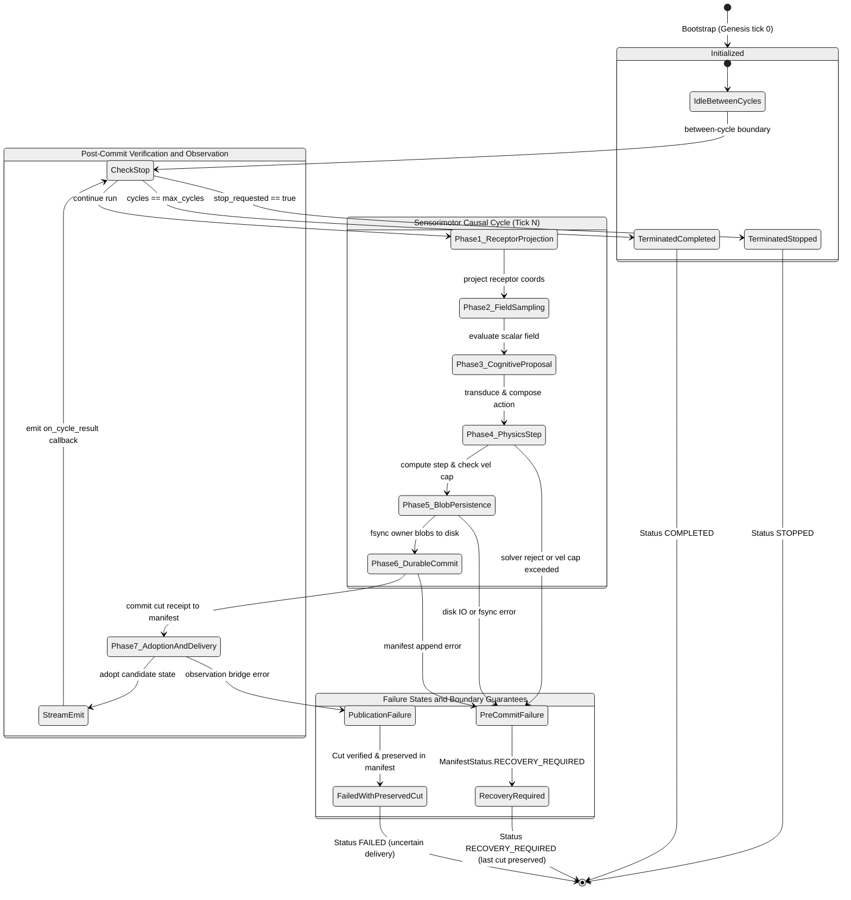

# The sensorimotor causal cycle

Reviewed against `world` at commit `76680345941fb627764ad831deded267dc11777c`
(main on 2026-10-15). Statements are marked by what supports them: the code,
the tests, or an accepted decision.

## What it is

The sensorimotor causal cycle is the end-to-end operational loop that
integrates an Organism, an articulated Embodiment, an Environment holding a
finite resource field, and the durable World runtime into a single, repeatable
causal transition.

The coordinator is implemented in
`world:src/world/causal_cycle.py::run_scalar_sensorimotor_cycle_and_publish`
(single tick) and `run_scalar_sensorimotor_session` (multi-cycle session loop).
It replaces test-only simulation fixtures with a production coordination
path, proving that the multi-owner architecture executes and continues across
restarts without losing causal integrity
(`world:tests/integration/test_end_to_end_causal_cycle_acceptance.py`).

## The operational sequence

Each tick of the cycle advances through seven explicit stages:

1. **Receptor sample projection:** Embodiment projects the receptor sample
   point in the world reference frame at the source cut
   (`project_receptor_sample_point`).
2. **Environment field sampling:** Environment evaluates the scalar field at
   the receptor coordinates from a restored checkpoint, emitting a correlated
   `FiniteScalarFieldSample`.
3. **Cognitive perception and proposal:** The scalar sample is transduced via
   Modality (`DimensionlessScalarFieldIdentityV1`) and ingested by Organism
   (`advance_organism_from_scalar_field_for_physical_step`). Organism's
   action composer proposes a bounded motor exploration command and prepares
   its candidate checkpoint.
4. **Articulated physics advancement:** MuJoCo executes the physical step
   (`advance_articulated_mujoco_step_from_motor_command`), composing motor
   activations into joint torques, stepping the solver, and emitting
   articulated body pose and static scene candidates.
5. **Opaque checkpoint persistence:** The serialized checkpoint bytes of
   Organism, Embodiment, and Environment are written atomically to disk by
   `FileOwnerCheckpointStore` (`world:src/world/owner_checkpoint_store.py`).
6. **Durable World commit:** World commits the transition to the append-only
   manifest and journal (`world.tick()`), generating a tamper-resistant
   `CommittedWorldCut` receipt.
7. **Post-commit adoption and observation:** Owners adopt the candidate state
   against the verified receipt (`adopt_after_world_commit`), and World
   publishes verified owner observations to the observation plane.

## The owner checkpoint store and genesis persistence

World stores owner checkpoints without inspecting or decoding their internal
contents.

The storage abstraction is implemented by `FileOwnerCheckpointStore`
(`world:src/world/owner_checkpoint_store.py:50`):
- It accepts opaque `OwnerCheckpointPayload` bytes, storing them in
  content-addressed files (`.checkpoint` or `.blob`) named by their lowercase SHA-256
  digest.
- Writes are performed atomically using a temporary file, `os.fsync`, and
  an atomic rename.
- Reading returns the verified raw bytes, confirming that the content matches
  its content-addressed locator.
- **Genesis persistence (`write_genesis`, lines 81-100):** Writes initial owner
  checkpoint payloads directly to disk prior to the first tick using locator format
  `root / digest[:2] / f"{digest}.blob"` and checkpoint ID
  `f"genesis:{digest[:24]}"`. This allows clean bootstrap of `DurableWorldRuntime`
  at tick 0 without requiring a preceding physical step context.

## Multi-cycle session loop and streaming execution

For multi-cycle simulation runs, `run_scalar_sensorimotor_session`
(`world:src/world/causal_cycle.py:613-760`) coordinates sequential execution
under explicit bounds:

- **Finite and continuous modes:** When `max_cycles` is a positive integer,
  advances sequentially through ticks up to that bound. When `max_cycles=None`,
  the session operates in continuous mode, requiring a callable `stop_requested`
  predicate. State outputs (`sensory_input.state`, `body_state.root`,
  `body_state`) are carried forward strictly into the next cycle's inputs.
- **Bounded-memory streaming (`retain_cycle_results`):** Continuous callers can
  set `retain_cycle_results=False` to consume results cycle-by-cycle through the
  `on_cycle_result` callback. The session reports `completed_cycle_count` while
  leaving `cycles=()`, bounding memory consumption over arbitrarily long runs.
- **Cooperative boundary interruption:** A thread-safe stop callback
  (`stop_requested()`) is sampled strictly **between** cycles (lines 707–709).
  If a stop is requested (e.g., via SIGINT or SIGTERM), the session completes
  the active cycle, commits to disk, and halts cleanly with status
  `ScalarSensorimotorSessionStatus.STOPPED`. In-flight physics, durable commit,
  and observation delivery are never aborted mid-execution.
- **Preservation of committed cuts during publication failure:** If a cycle's
  causal transition commits durably but subsequent observation publication
  fails, the session returns `ScalarSensorimotorSessionStatus.FAILED`.
  Crucially, the committed World cut is **preserved** and reverified against the
  store manifest; it is never rolled back or retried. The session result records
  `publication_delivery_status_uncertain = True` to notify the operator.
- **Cut preservation on latch recovery:** If a transition fails after recovery
  becomes required (`ManifestStatus.RECOVERY_REQUIRED`), the session preserves
  the previously verified `last_cut` receipt rather than erasing it with `None`.
  The failure is reported truthfully without falsely claiming absence of earlier
  committed history (`test_world_owned_session_preserves_last_verified_cut_when_recovery_is_required`).

## Restoration and live continuation

The cycle proves full crash-recovery continuation through
`restore_scalar_sensorimotor_runtime` (`world:src/world/causal_cycle.py:148`).

Given a durable World runtime and the latest committed cut:
1. World verifies the committed cut and reads the corresponding checkpoint
   bytes from the owner checkpoint store.
2. Organism, Embodiment, and Environment are restored from their exact
   committed checkpoint bytes.
3. Actuator applicability and surface fingerprints are validated.
4. Subsequent ticks executed on the restored runtime produce bit-identical
   causal journal records, body poses, and checkpoint digests when compared to
   uninterrupted live execution
   (`test_restored_causal_cycle_matches_live_continuation`).

## What supports this description

| Claim | Support |
|---|---|
| Complete cycle coordination and 7-stage sequence | Code in `world:src/world/causal_cycle.py` |
| Bounded and continuous session loop, streaming execution, cooperative stopping, and cut preservation | Code in `world:src/world/causal_cycle.py:613-760` and tests in `world:tests/integration/test_end_to_end_causal_cycle_acceptance.py` |
| Articulated MuJoCo execution from motor commands | Code in `world:src/world/adapters/articulated_mujoco.py` |
| Atomic owner checkpoint and genesis persistence | Code in `world:src/world/owner_checkpoint_store.py` and tests in `world:tests/test_owner_checkpoint_store.py` |
| Full state restoration and continuation matching live execution | Acceptance tests in `world:tests/integration/test_end_to_end_causal_cycle_acceptance.py` |
| Preserved domain ownership and passivity of observation | Accepted decisions ADR-0073, ADR-0078, ADR-0095 |
